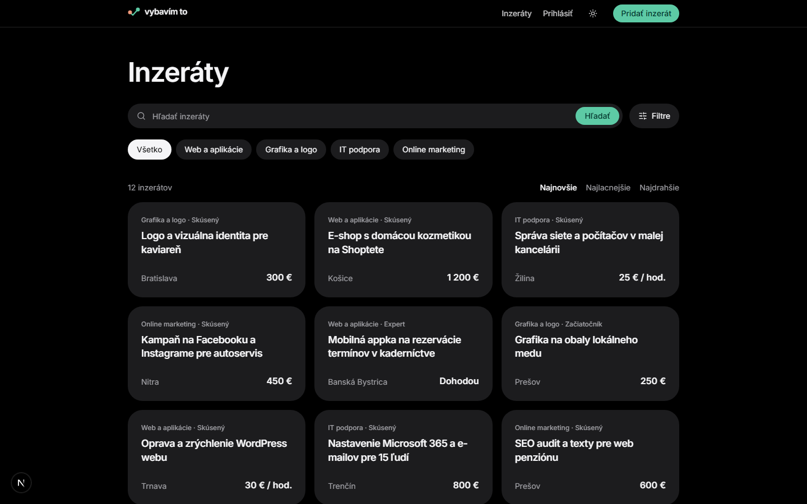
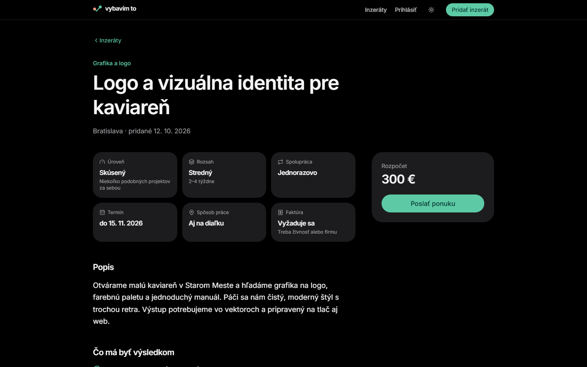
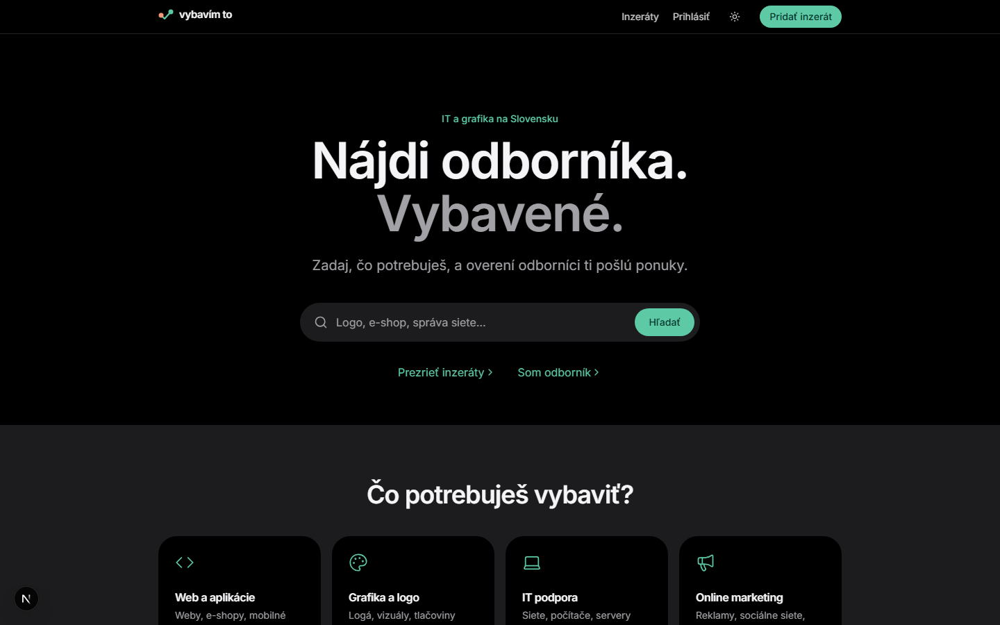
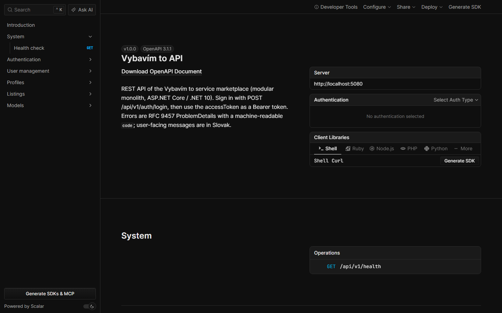
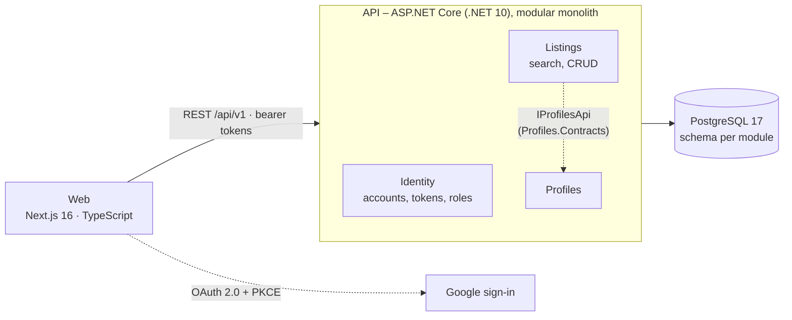

# Vybavím to

[](https://github.com/Petus19/Vybavim_to/actions/workflows/ci.yml)

**A two-sided service marketplace** – people and small businesses post a job ("logo for my café", "office network support"), and freelancers or agencies respond. The first target market is IT and graphic design in Slovakia (hence the Slovak UI; *Vybavím to* means *"I'll get it done"*).

> **Status:** work in progress (started October 2026). Browsing and search, accounts (email/password + Google) and posting/managing listings work end to end (web + API + database). User profiles are done in the API; the profile page on the web is next. Then offers, chat and reviews – see [Roadmap](#roadmap).

| Listings with search and filters | Listing detail |
|---|---|
|  |  |
| **Home page** | **Interactive API documentation (OpenAPI + Scalar)** |
|  |  |

---

## What this project shows

- **Backend architecture** – a *modular monolith* in C# / ASP.NET Core (.NET 10): each business module owns its code, its database schema and a small public contract. Module boundaries are enforced by the compiler **and** by automated architecture tests.
- **Domain modelling** – entities protect their own rules (factory methods, private setters, explicit state transitions); every broken rule has a stable error code and a human-readable message.
- **A real REST API** – search with accent-insensitive full-text and filters, paging, authentication with access/refresh tokens and Google sign-in, role-based authorization, RFC 9457 error responses, OpenAPI docs.
- **Testing and CI** – 95 automated tests: unit, architecture, and integration tests that run the whole API against a throw-away PostgreSQL in Docker (Testcontainers). GitHub Actions builds and tests the backend and frontend on every pull request.
- **Teamwork** – two developers, every change goes through a branch, a descriptive pull request and a green CI run. The web client consumes TypeScript types generated from the API's OpenAPI document.

## Team

| | Role |
|---|---|
| **Petus19** | Backend (C#, database, API, authentication, tests, CI) |
| **Samuel Chovanec** | Frontend (Next.js), Docker development environment |

> **Language note:** the product targets Slovak users, so the UI, code comments and commit messages are in Slovak (the team's working language). Identifiers, API contracts and this documentation are in English.

---

## Architecture



```
Backend/
  Api/                 host: wires modules, OpenAPI, auth, error handling – no business logic
  Common/              shared technical code (DB base class, errors/Result, current user)
  Modules/<Module>/
    <Module>/          implementation – everything internal
      Endpoints/       HTTP endpoints (thin: call a use case, map the result)
      Application/     use cases (return Result<T>)
      Domain/          entities and business rules
      Infrastructure/  EF Core DbContext, mappings, migrations, dev seed data
    <Module>.Contracts/   the ONLY thing other modules may reference
  Tests/               unit, architecture and integration tests
Frontend/
  Web/                 Next.js app (Slovak UI)
  Shared/              TypeScript API types generated from OpenAPI
```

**Rules that keep it maintainable**

1. A module may reference another module **only through its `.Contracts` project** (e.g. Listings asks Profiles for the listing author via `IProfilesApi`). No circular dependencies, no reaching into another module's tables.
2. Everything inside a module is `internal`; the only public type is `{Module}Module` (`AddListingsModule()`, `MapListingsEndpoints()`).
3. Each module has its **own PostgreSQL schema** and migration history (`identity`, `profiles`, `listings`).
4. Expected errors are values (`Error` + `Result<T>`), mapped to `400/401/403/404/409` ProblemDetails with a `code` field the web uses to highlight form fields.
5. Rules 1–3 are checked by **architecture tests** (reflection over the compiled assemblies).

Modules that exist as empty skeletons for later phases: Projects, Chat, Notifications, Reviews, Payments, Admin, Gdpr.

### Where to look in the code

| What | File |
|---|---|
| Domain entity with rules and state transitions | [`Modules/Listings/Listings/Domain/Listing.cs`](Backend/Modules/Listings/Listings/Domain/Listing.cs) |
| Search query (filters → one SQL statement) | [`Modules/Listings/Listings/Application/SearchListings.cs`](Backend/Modules/Listings/Listings/Application/SearchListings.cs) |
| Cross-module contract and its use | [`Profiles.Contracts/IProfilesApi.cs`](Backend/Modules/Profiles/Profiles.Contracts/IProfilesApi.cs), [`GetListingDetail.cs`](Backend/Modules/Listings/Listings/Application/GetListingDetail.cs) |
| Authentication use case | [`Modules/Identity/Identity/Application/LoginUser.cs`](Backend/Modules/Identity/Identity/Application/LoginUser.cs) |
| Architecture tests | [`Tests/ArchitectureTests/ModuleBoundaryTests.cs`](Backend/Tests/ArchitectureTests/ModuleBoundaryTests.cs) |
| Integration tests (API + real PostgreSQL) | [`Tests/IntegrationTests/ListingsManageTests.cs`](Backend/Tests/IntegrationTests/ListingsManageTests.cs) |
| Composition root | [`Api/Program.cs`](Backend/Api/Program.cs) |

## Tech stack

| Area | Technology |
|---|---|
| Backend | C#, .NET 10, ASP.NET Core Minimal APIs, ASP.NET Core Identity, EF Core + Npgsql |
| Database | PostgreSQL 17 (`unaccent` full-text; PostGIS and pgvector available in the image) |
| Frontend | Next.js 16, React 19, TypeScript, Tailwind CSS 4, shadcn/ui, openapi-fetch |
| Auth | Bearer access/refresh tokens, roles, Google sign-in (OAuth 2.0 + PKCE), lockout after failed logins |
| API docs | OpenAPI + Scalar UI |
| Testing | xUnit v3 (Microsoft.Testing.Platform), Testcontainers, WebApplicationFactory |
| Dev environment | Docker Compose: PostgreSQL, Redis, S3-compatible storage (RustFS), Mailpit |
| CI | GitHub Actions |

---

## Getting started

**Prerequisites:** [Docker](https://www.docker.com/products/docker-desktop/) (running), [.NET 10 SDK](https://dotnet.microsoft.com/download/dotnet/10.0), [Node.js 24](https://nodejs.org/) – works on Windows, macOS and Linux.

```bash
git clone https://github.com/Petus19/Vybavim_to.git
cd Vybavim_to

# 1. Infrastructure: PostgreSQL, Redis, storage, mail catcher
docker compose up -d

# 2. API – applies database migrations and loads demo data on first start
cd Backend
dotnet run --project Api
#    → http://localhost:5080/scalar   (interactive API docs)
```

In a second terminal:

```bash
# 3. Web
cd Frontend/Web
npm install
npm run dev
#    → http://localhost:3000
```

**Demo data:** 4 categories, 12 listings and their authors' profiles are created automatically in development. A development-only admin account is seeded as well: user `Admin`, password `Admin123` (never created outside the Development environment). You can also register a new account on the web.

**Google sign-in is optional** – the button appears only when `GOOGLE_CLIENT_ID` and `GOOGLE_CLIENT_SECRET` are set in `Frontend/Web/.env.local` (see `.env.example`). Everything else works without it.

### Running the tests

```bash
cd Backend
dotnet test        # 95 tests; Docker must be running (integration tests start their own PostgreSQL)
```

```bash
cd Frontend/Web
npm run lint && npm run typecheck && npm run build
```

### Troubleshooting

| Problem | Fix |
|---|---|
| API fails on start with a connection error | Docker is not running, or run `docker compose up -d` in the repository root |
| Port already in use (5432, 6379, …) | copy `.env.example` to `.env` and change the port; for the database port also update `Backend/Api/appsettings.Development.json` |
| Web shows "Niečo sa nepodarilo" (*something went wrong*) | the API is not running on `http://localhost:5080` |

---

## API overview

Base URL `http://localhost:5080/api/v1` · full reference in [`Backend/Api/README.md`](Backend/Api/README.md) and at `/scalar`.

| Method | Endpoint | Access | Purpose |
|---|---|---|---|
| POST | `/auth/register`, `/auth/login`, `/auth/google`, `/auth/refresh` | public | accounts and tokens |
| GET | `/auth/me` | signed in | current user and roles |
| GET | `/users` | admin | user list |
| GET / PUT | `/profiles/me` | signed in | my profile (create or update) |
| GET | `/profiles/{userId}` | public | public profile |
| GET | `/categories` | public | categories |
| GET | `/listings` | public | search: text, category, city, price type and ranges, level, remote, sort, paging |
| GET | `/listings/{id}` | public | detail including the author's profile |
| POST / PUT | `/listings`, `/listings/{id}` | signed in / author | create, edit |
| POST | `/listings/{id}/cancel` | author or admin | withdraw a listing |
| GET | `/listings/mine` | signed in | my listings |

---

## Roadmap

| Phase | Scope | Status |
|---|---|---|
| 0 – Foundation | architecture, Docker, database, search API, tests, CI | ✅ done |
| 1 – MVP | accounts ✅, Google sign-in ✅, profiles ✅, posting listings ✅, **offers on listings**, choosing a specialist → project, chat, reviews, email notifications, GDPR tools | in progress |
| 2 – Monetization & AI | Stripe subscriptions; first AI features in a separate **Python (FastAPI) service**: listing-writing assistant (LLM), semantic search with pgvector embeddings, content moderation | planned |
| 3 – Growth | mobile app (Expo) on the same API, escrow payments, matching/recommendations and fraud detection (ML) | planned |

The AI service will subscribe to domain events and call the public module APIs instead of reading the database directly, so it has the same permissions as a regular user.

The original technical design document (Slovak) is in [`docs/technical-design.sk.md`](docs/technical-design.sk.md).
