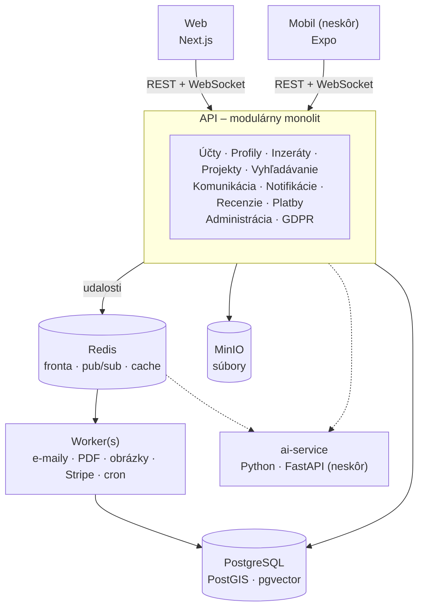

# Vybavím to

Webová platforma, ktorá spája **zadávateľov projektov** s **odborníkmi** (freelancermi a firmami).

> **Stav:** technický návrh (október 2026). Implementácia ešte nezačala, ďalší krok je [Fáza 0](#plán-vývoja).

---

## O projekte

Vybavím to je **dvojstranný marketplace**: na jednej strane sú zadávatelia projektov, na druhej odborníci. Technicky je to dobre zvládnuteľný projekt. Hlavné riziko nie je v kóde, ale v **probléme sliepky a vajca**: bez odborníkov neprídu zadávatelia a bez zadávateľov neprídu odborníci.

**Zásady:**

- **Začať úzko**, napríklad iba IT a grafika na Slovensku. Ďalšie kategórie pridávať postupne.
- **Najprv MVP.** Gamifikácia, B2B, marketplace šablón, kurzy, affiliate a blog prídu v neskorších fázach.
- **Najprv web, potom mobil.** Backend je **API-first**, takže ho mobilná aplikácia použije bez prerábania.
- **Všetko beží v Dockeri**, vo vývoji aj v produkcii.

---

## Technologický stack

| Vrstva | Voľba | Prečo |
|---|---|---|
| Frontend | **Next.js** (React, TypeScript) | SEO pre verejné inzeráty, SSR, veľký ekosystém |
| Backend API | **NestJS** (TS) alebo **ASP.NET Core** (C#) | Jedno API pre web aj mobil, WebSockety, webhooky |
| Worker | BullMQ (TS) / Hangfire (C#) | Úlohy na pozadí, opakovanie pri chybe, cron |
| Databáza | **PostgreSQL** + PostGIS + pgvector | Relačné dáta, fulltext, lokalita, embeddingy pre AI |
| ORM | Prisma / Drizzle (TS), EF Core (C#) | Typovo bezpečný prístup k dátam a migrácie |
| Cache a fronty | **Redis** | Fronta úloh, real-time (pub/sub), cache, sessions |
| Súbory | **MinIO** (v produkcii S3) | Portfóliá, prílohy v chate, logá firiem |
| Real-time | Socket.IO (TS) / SignalR (C#) | Chat a notifikácie |
| Autentifikácia | E-mail + Google/Apple (OAuth) | Access + refresh token pre web aj mobil |
| Platby | **Stripe** (neskôr Stripe Connect) | Predplatné, topovanie, faktúry, neskôr escrow |
| AI / ML | **Python** (FastAPI), samostatná služba | Celý ML ekosystém je v Pythone |
| Mobil *(neskôr)* | React Native / Expo | Zdieľanie typov a logiky s webom |

> Jazyk backendu ešte nie je rozhodnutý, porovnanie je v časti [Otvorené rozhodnutia](#otvorené-rozhodnutia).

---

## Architektúra

Architektúra je **modulárny monolit**: jedna backendová aplikácia rozdelená do jasne oddelených modulov a k nej samostatný worker. Jedinou výnimkou je AI služba v Pythone.



### Prečo nie mikroslužby

- Pre malý tím znamenajú niekoľkonásobne viac práce: sieťovú komunikáciu, distribuované transakcie a zložité ladenie aj nasadenie.
- Ich výhody sa v MVP nevyužijú.
- Dobre oddelený modul sa dá neskôr vytiahnuť do samostatnej služby bez prepisovania.

### Pravidlá architektúry

1. **Moduly si nesiahajú do tabuliek.** Modul komunikuje s iným modulom iba cez jeho verejné rozhranie.
2. **Komunikácia cez udalosti.** Napríklad modul Projekty vyšle `ProjectCompleted`, Recenzie potom vyzvú na hodnotenie a Notifikácie pošlú e-mail. Moduly o sebe nemusia vedieť.
3. **Outbox pattern.** Udalosť sa uloží do DB v tej istej transakcii ako zmena a až potom ide do fronty. Pri výpadku Redisu sa tak nič nestratí, čo je dôležité najmä pri platbách.
4. **Vrstvy v každom module:**
   - `api/`: kontroléry, validácia vstupu
   - `application/`: prípady použitia („pridaj inzerát“, „odpovedz na inzerát“)
   - `domain/`: biznis pravidlá (napr. recenzia iba k dokončenému projektu)
   - `infrastructure/`: databáza, externé služby
5. **API-first.** REST s OpenAPI dokumentáciou a verziovaním (`/api/v1/…`). Web aj mobil si z neho generujú typovaného klienta. Biznis logika nepatrí do frontendu.
6. **Autentifikácia.** Krátkodobý access token a refresh token, ktorý je na webe v httpOnly cookie a v mobile v bezpečnom úložisku.

---

## Moduly

| Modul | Priečinok | Zodpovednosť |
|---|---|---|
| Účty | `identity/` | Registrácia a prihlásenie (e-mail, Google, Apple), overenie identity, nastavenia a preferencie |
| Profily | `profiles/` | Jednotlivec (meno, profesia, portfólio, kontakty) a firma (názov, popis, logo, projekty) |
| Inzeráty | `listings/` | Pridanie inzerátu: kategória, popis, rozpočet, harmonogram; topovanie |
| Projekty | `projects/` | Z odpovede na inzerát vznikne projekt; stavy *otvorený → prebieha → dokončený* |
| Vyhľadávanie | `search/` | Fulltext, filtre (kategória, cena, lokalita, typ projektu), obľúbené inzeráty |
| Komunikácia | `chat/` | Interný chat, textové správy, zdieľanie súborov |
| Notifikácie | `notifications/` | Odpovede na inzeráty, nové správy, zmeny v projektoch; e-mail, in-app, neskôr push |
| Recenzie | `reviews/` | Hodnotenie 1–5 ★, textová recenzia, história spolupráce, nahlasovanie používateľov |
| Platby | `payments/` | Predplatné, topovanie, Stripe, faktúry a výkazy |
| Administrácia | `admin/` | Moderovanie obsahu, štatistiky, správa predplatného a platieb |
| GDPR | `gdpr/` | Ochrana osobných údajov, šifrovanie komunikácie, súhlasy, export a zmazanie dát |

---

## Databáza: PostgreSQL

Dáta platformy sú výrazne relačné: *používateľ → inzerát → odpoveď → projekt → recenzia → platba*. PostgreSQL navyše pokryje viac potrieb bez ďalších služieb:

| Potreba | Riešenie v PostgreSQL |
|---|---|
| Fulltextové vyhľadávanie | `tsvector` + `unaccent` (slovenská diakritika), netreba Elasticsearch |
| Filtrovanie podľa lokality | PostGIS |
| Rôzne atribúty podľa kategórie | stĺpce typu `JSONB` |
| Platby a predplatné | ACID transakcie |
| AI: sémantické vyhľadávanie, odporúčania | `pgvector`, netreba samostatnú vektorovú DB |

> MongoDB neodporúčame, lebo relačné väzby a transakcie by sa museli riešiť v aplikácii.

---

## Úlohy na pozadí

Treba rozlišovať dve veci:

- **Asynchrónny kód (`async/await`)**: server nečaká zablokovaný na databázu či sieť a medzitým obsluhuje iných používateľov. Node.js aj .NET to zvládajú rovnako dobre.
- **Úlohy na pozadí**: práca, ktorá beží mimo požiadavky používateľa. Používateľ dostane odpoveď hneď a úloha sa spracuje neskôr. Na to treba **frontu (Redis) a samostatný worker**. Samotné `async` nestačí, pretože pri reštarte servera by sa úloha stratila.

**Spoľahlivosť teda nezávisí od jazyka, ale od architektúry API + fronta + worker.**

Čo bude bežať na pozadí:

- e-maily (overenie účtu, nová odpoveď na inzerát, nová správa)
- notifikácie (in-app, neskôr push na mobil)
- spracovanie obrázkov a súborov (zmenšenie, náhľady, kontrola)
- generovanie faktúr (PDF)
- spracovanie Stripe webhookov (platba prebehla, predplatné vypršalo)
- plánované úlohy cez cron (vypršanie topovania a prémia, archivácia inzerátov, upomienky na recenziu)
- štatistiky pre administráciu a AI úlohy (embeddingy, moderácia)

| | TypeScript | C# |
|---|---|---|
| Fronta úloh | BullMQ (Redis) | Hangfire / MassTransit |
| Opakovanie, oneskorené úlohy, cron | áno | áno |
| Dashboard úloh | Bull Board | Hangfire Dashboard |
| Real-time | Socket.IO | SignalR |

---

## Štruktúra projektu

Plánovaná štruktúra monorepa:

```
vybavim-to/
├── apps/
│   ├── web/                  # Next.js, frontend
│   ├── api/                  # backend, modulárny monolit
│   │   └── src/modules/
│   │       ├── identity/
│   │       ├── profiles/
│   │       ├── listings/
│   │       ├── projects/
│   │       ├── search/
│   │       ├── chat/
│   │       ├── notifications/
│   │       ├── reviews/
│   │       ├── payments/
│   │       ├── admin/
│   │       └── gdpr/
│   ├── worker/               # spracovanie úloh z fronty
│   └── ai-service/           # Python / FastAPI (neskôr)
├── packages/
│   └── shared/               # typy, validačné schémy, API klient
├── docker-compose.yml        # vývoj
└── docker-compose.prod.yml   # produkcia
```

> **Variant v C#:** jedno solution, každý modul ako samostatný projekt (`Vybavim.Listings`, `Vybavim.Payments`, …). Worker je `BackgroundService` alebo Hangfire server.

---

## Docker

| Služba | Image / technológia | Účel |
|---|---|---|
| `web` | Next.js | Frontend |
| `api` | NestJS / ASP.NET Core | REST API + WebSockety |
| `worker` | rovnaký kód ako `api` | Úlohy z fronty, škáluje sa samostatne |
| `db` | `postgres:17` + PostGIS + pgvector | Hlavná databáza |
| `redis` | `redis:7` | Fronta úloh, real-time, cache |
| `minio` | MinIO | S3-kompatibilné úložisko súborov |
| `mailpit` | Mailpit | Zachytávanie e-mailov pri vývoji |
| `ai-service` | Python / FastAPI | AI a ML *(neskôr)* |

**Škálovanie neskôr bez prepisovania:**

1. viac kópií `api` a `worker` za load balancerom
2. Redis adapter pre WebSockety (chat cez viac serverov)
3. read repliky PostgreSQL pre vyhľadávanie
4. podľa potreby oddelenie modulu (napr. chatu) do samostatnej služby

---

## Plán vývoja

### Fáza 0: základ

- [ ] Monorepo, Docker Compose, CI, lint, typecheck
- [ ] Návrh DB schémy: `users`, `profiles`, `categories`, `listings`, `applications`, `projects`, `messages`, `reviews`
- [ ] Zber udalostí (analytika) od prvého dňa ako podklad pre budúce ML

### Fáza 1: MVP

- [ ] Používateľské účty: registrácia, prihlásenie (e-mail + Google), profil jednotlivca / firmy
- [ ] Inzeráty: pridanie a zoznam
- [ ] Vyhľadávanie a filtre: kategória, cena, lokalita
- [ ] Odpovede na inzerát a interný chat
- [ ] Stav projektu: otvorený → prebieha → dokončený
- [ ] Recenzie, iba po dokončenom projekte
- [ ] GDPR: súhlasy, export a zmazanie účtu
- [ ] Základná administrácia a moderovanie

### Fáza 2: monetizácia

- [ ] Stripe: prémiové účty, topovanie inzerátov, faktúry
- [ ] Notifikácie (e-mail + in-app), obľúbené inzeráty, nahlasovanie používateľov
- [ ] Prvé AI funkcie: asistent pri písaní inzerátu, sémantické vyhľadávanie, moderácia

### Fáza 3: rast

- [ ] Mobilná aplikácia (Expo) nad existujúcim API
- [ ] Escrow a provízie cez Stripe Connect
- [ ] AI agent, odporúčania a párovanie, detekcia podvodov
- [ ] Gamifikácia, B2B riešenia, marketplace šablón, vzdelávací obsah, affiliate

---

## AI a strojové učenie

| Funkcia | Typ |
|---|---|
| Párovanie vhodných odborníkov k inzerátu a naopak | ML / embeddingy |
| Sémantické vyhľadávanie („logo pre kaviareň“ nájde grafikov) | embeddingy (pgvector) |
| Asistent pri písaní inzerátu: popis, kategória, rozpočet, termín | LLM |
| Automatická moderácia: spam, podvody, nevhodný obsah | LLM / klasifikátor |
| Detekcia podvodov a obchádzania platformy | ML |
| Agent pre používateľa („nájdi 3 programátorov do 2000 € a pošli dopyt“) | LLM agent s nástrojmi |
| Odporúčanie ceny podľa podobných projektov | ML |

**Zapojenie do architektúry:**

- `ai-service` je samostatná služba v Pythone (FastAPI) a jediná výnimka z monolitu.
- **Synchrónne volania** (asistent, agent v chate) idú cez API do `ai-service` a výstup sa streamuje do webu.
- **Asynchrónne úlohy** (embeddingy, moderácia, detekcia podvodov) idú cez frontu a worker.
- Agent **nepristupuje priamo k databáze**. Ako nástroje volá verejné API modulov, takže má rovnaké oprávnenia ako používateľ.
- Ak pôjde iba o LLM cez API bez vlastných modelov, dá sa to postaviť aj priamo v TS/C#. Python je nutný až pri vlastnom tréningu.

**Čo pripraviť už v MVP:**

1. PostgreSQL s rozšírením `pgvector`
2. zber dát od začiatku: zobrazenia, kliknutia, odpovede, dokončené projekty, hodnotenia
3. doménové udalosti (`ListingCreated`, `ProjectCompleted`, …), na ktoré sa `ai-service` iba prihlási
4. rezervované miesto pre `ai-service` v Docker Compose
5. GDPR a AI Act: súhlas so spracovaním pomocou AI, označenie komunikácie s AI, ľudská kontrola pri automatických rozhodnutiach

---

## Monetizácia

| Model | Kedy | Poznámka |
|---|---|---|
| Predplatné (firmy, profesionáli) | Fáza 2 | Rozšírené možnosti inzerátov, neobmedzené odpovede |
| Topovanie / platené inzeráty | Fáza 2 | Jednoduché na implementáciu, okamžitý príjem |
| Reklama, cielené reklamy | Fáza 2–3 | Až pri dostatočnej návštevnosti |
| Provízia 5–10 % / pay-per-lead | Fáza 3 | Funguje iba s escrow (Stripe Connect) |
| Marketplace šablón, kurzy, B2B, affiliate | Fáza 3+ | Po overení hlavného produktu |

> ⚠️ **Pozor:** províziu je bez escrow ťažké vymáhať. Keď sa strany skontaktujú cez chat, zaplatia si mimo platformy. Na začiatok sú preto vhodnejšie predplatné a topovanie.

---

## Otvorené rozhodnutia

- [ ] **Jazyk backendu:** TypeScript (NestJS) alebo C# (ASP.NET Core)
- [ ] **Úvodná nika:** ktoré kategórie a ktorý región na štart
- [ ] **ORM:** Prisma alebo Drizzle (pri TS), EF Core (pri C#)
- [ ] **Hosting produkcie:** VPS s Docker Compose alebo spravovaná cloudová služba

### TypeScript vs. C#

Frontend bude v TypeScripte v každom prípade, rozhoduje sa iba o jazyku backendu.

| TypeScript (NestJS) | C# (ASP.NET Core) |
|---|---|
| ✅ Jeden jazyk pre web, API aj mobilnú appku | ✅ Vyšší výkon, plnohodnotná viacvláknovosť |
| ✅ Zdieľané typy a validačné schémy (Zod) | ✅ Prísne typy aj za behu, vyspelé EF Core a SignalR |
| ✅ Menej prepínania kontextu pre malý tím | ✅ Na Slovensku veľa .NET vývojárov |
| ❌ Slabší pri ťažkých výpočtoch v CPU (jedno vlákno) | ❌ Frontend aj tak v React/Next.js, teda dva jazyky |

**Odporúčanie:** rozhoduje, čo tím ovláda lepšie. Pri C# je osvedčená kombinácia ASP.NET Core API + Next.js + PostgreSQL, pri TS celý stack v TypeScripte. Na úlohy na pozadí ani na AI to vplyv nemá.

---

## Ďalší krok

Po rozhodnutí o jazyku nasleduje kostra projektu: monorepo, Docker Compose, modulárny monolit, worker, PostgreSQL + pgvector, Redis, MinIO a prvá databázová schéma pre Fázu 1.
