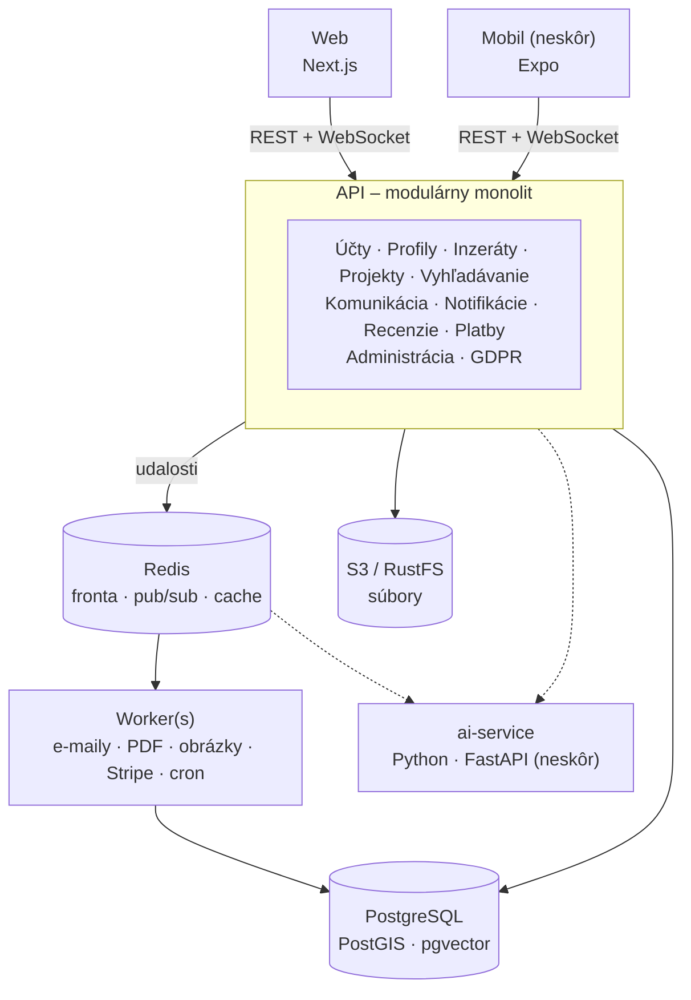

# Vybavím to

Webová platforma, ktorá spája **zadávateľov projektov** s **odborníkmi** (freelancermi a firmami).

> **Note (EN):** this is the original technical design and team working document in Slovak. The English overview for reviewers is the main [README](../README.md).
>
> **Poznámka:** pôvodný technický návrh a pracovný dokument tímu. Aktuálny stav je v hlavnom [README](../README.md) a v README jednotlivých častí.

---

## O projekte

Vybavím to je **dvojstranný marketplace**: na jednej strane sú zadávatelia projektov, na druhej odborníci. Technicky je to dobre zvládnuteľný projekt. Hlavné riziko nie je v kóde, ale v **probléme sliepky a vajca**: bez odborníkov neprídu zadávatelia a bez zadávateľov neprídu odborníci.

**Zásady:**

- **Začať úzko**, napríklad iba IT a grafika na Slovensku. Ďalšie kategórie pridávať postupne.
- **Najprv MVP.** Gamifikácia, B2B, marketplace šablón, kurzy, affiliate a blog prídu v neskorších fázach.
- **Najprv web, potom mobil.** Backend je **API-first**, takže ho mobilná aplikácia použije bez prerábania.
- **Všetko beží v Dockeri**, vo vývoji aj v produkcii.

---

## Ako začať

Vyvíjame na macOS aj Windows. Rovnaké prostredie zabezpečuje git: verzie nástrojov aj Docker image sú zafixované v repozitári, nič sa nenastavuje ručne.

### 1. Nainštaluj nástroje

| Nástroj | macOS | Windows |
|---|---|---|
| Docker Desktop (aktuálna verzia) | `brew install --cask docker-desktop` | `winget install Docker.DockerDesktop` (vyžaduje WSL2: `wsl --install`) |
| .NET SDK 10 (verzia v `Backend/global.json`) | `brew install --cask dotnet-sdk` | `winget install Microsoft.DotNet.SDK.10` |
| Node.js cez `fnm` (verzia v `Frontend/Web/.nvmrc`) | `brew install fnm` | `winget install Schniz.fnm` |
| Git | `brew install git` | `winget install Git.Git` |

Potom raz nastav dôveryhodný HTTPS certifikát pre lokálny vývoj:

```bash
dotnet dev-certs https --trust
```

### 2. Naklonuj repozitár

```bash
git clone https://github.com/Petus19/Vybavim_to.git
```

Na Windowse ideálne do priečinka bez diakritiky a medzier, napr. `C:\dev\Vybavim_to`.

### 3. Spusti infraštruktúru

```bash
docker compose up -d
```

Spustí PostgreSQL, Redis, RustFS a Mailpit. Adresy a prihlasovacie údaje sú v časti [Docker](#docker). Ak je niektorý port obsadený, skopíruj `.env.example` do `.env` a port v ňom zmeň.

### 4. Spusti backend (API)

```bash
cd Backend
dotnet run --project Api
```

API beží na http://localhost:5080 (dokumentácia na `/scalar`). Pri štarte sa aplikujú migrácie a naplnia sa testovacie dáta.

### 5. Spusti web

V druhom termináli:

```bash
cd Frontend/Web
npm install
npm run dev
```

Web beží na http://localhost:3000 a načítava dáta z API. Podrobnosti sú vo [`Frontend/Web/README.md`](../Frontend/Web/README.md).

### Bežná práca

| Situácia | Príkaz |
|---|---|
| Po `git pull` (mohlo sa zmeniť prostredie) | `docker compose up -d --build` |
| Vypnutie (dáta zostanú) | `docker compose down` |
| Reset – zmaže lokálnu DB a súbory | `docker compose down -v` |

Databázu si nezdieľame, každý má vlastnú. Rovnakú schému a dáta zabezpečia migrácie a seed s mock dátami.

---

## Technologický stack

| Vrstva | Voľba | Prečo |
|---|---|---|
| Frontend | **Next.js** (React, TypeScript) | SEO pre verejné inzeráty, SSR, veľký ekosystém |
| Backend API | **ASP.NET Core** (C#, .NET 10), Minimal APIs | Jedno API pre web aj mobil, WebSockety, webhooky |
| Worker | .NET Worker Service + Hangfire alebo Wolverine | Úlohy na pozadí, opakovanie pri chybe, cron |
| Databáza | **PostgreSQL** + PostGIS + pgvector | Relačné dáta, fulltext, lokalita, embeddingy pre AI |
| ORM | **EF Core** + Npgsql | Typovo bezpečný prístup k dátam a migrácie |
| Cache a fronty | **Redis** | Fronta úloh, real-time (pub/sub), cache, sessions |
| Súbory | **S3** (lokálne RustFS) | Portfóliá, prílohy v chate, logá firiem |
| Real-time | **SignalR** | Chat a notifikácie |
| Autentifikácia | E-mail + Google/Apple (OAuth) | Access + refresh token pre web aj mobil |
| Platby | **Stripe** (neskôr Stripe Connect) | Predplatné, topovanie, faktúry, neskôr escrow |
| AI / ML | **Python** (FastAPI), samostatná služba | Celý ML ekosystém je v Pythone |
| Mobil *(neskôr)* | React Native / Expo | Zdieľanie TS API klienta s webom |

> Backend je v **C#**, frontend v **TypeScripte**. Spájajú ich typy vygenerované z OpenAPI špecifikácie backendu.

---

## Architektúra

Architektúra je **modulárny monolit**: jedna backendová aplikácia rozdelená do jasne oddelených modulov a k nej samostatný worker. Jedinou výnimkou je AI služba v Pythone.



### Prečo nie mikroslužby

- Pre malý tím znamenajú niekoľkonásobne viac práce: sieťovú komunikáciu, distribuované transakcie a zložité ladenie aj nasadenie.
- Ich výhody sa v MVP nevyužijú.
- Dobre oddelený modul sa dá neskôr vytiahnuť do samostatnej služby bez prepisovania.

### Pravidlá architektúry

1. **Moduly si nesiahajú do tabuliek ani tried.** Každý modul tvoria dva projekty: implementácia (všetko `internal`) a `.Contracts` (rozhrania, DTO, udalosti). Iné moduly referencujú **iba `.Contracts`**, takže hranicu stráži kompilátor a nevzniknú cyklické závislosti (napr. Projects ↔ Listings). Volanie je v rámci procesu, nie cez HTTP.
2. **Komunikácia cez udalosti.** Napríklad modul Projekty vyšle `ProjectCompleted`, Recenzie potom vyzvú na hodnotenie a Notifikácie pošlú e-mail. Moduly o sebe nemusia vedieť.
3. **Outbox pattern.** Udalosť sa uloží do DB v tej istej transakcii ako zmena a až potom ide do fronty. Pri výpadku Redisu sa tak nič nestratí, čo je dôležité najmä pri platbách.
4. **Vrstvy v implementácii modulu** (priečinky, nie samostatné projekty; poradie strážia architektonické testy):
   - `Endpoints/`: REST endpointy pre web a mobil (Minimal APIs), validácia vstupu
   - `Application/`: prípady použitia („pridaj inzerát“, „odpovedz na inzerát“)
   - `Domain/`: entity a biznis pravidlá (napr. recenzia iba k dokončenému projektu)
   - `Infrastructure/`: DbContext modulu, migrácie, externé služby
5. **Vlastná DB schéma pre každý modul** (`listings`, `projects`, …) s vlastnou históriou migrácií. Vo vývoji migrácie spúšťa Api pri štarte, v produkcii samostatný krok pred nasadením.
6. **Žiadna duplicita, ale ani zdieľaná biznis logika.** Spoločný technický kód (pripojenie k DB, `BaseDbContext`, auth, chyby, extension metódy) je raz v `Backend/Common/`. Biznis logika tam nepatrí, zostáva vo svojom module.
7. **API-first.** REST s OpenAPI dokumentáciou a verziovaním (`/api/v1/…`). Web aj mobil si z neho generujú typovaného klienta. Biznis logika nepatrí do frontendu.
8. **Moduly naprieč všetkými dátami** (`Gdpr`, `Admin`) pracujú cez rozhrania v `.Contracts`. Každý modul napríklad implementuje export a anonymizáciu svojich osobných údajov a `Gdpr` ich iba zavolá.
9. **Autentifikácia.** Krátkodobý access token a refresh token, ktorý je na webe v httpOnly cookie a v mobile v bezpečnom úložisku.

---

## Moduly

Moduly sú v `Backend/Modules/`.

| Modul | Priečinok | Zodpovednosť |
|---|---|---|
| Účty | `Identity/` | Registrácia a prihlásenie (e-mail, Google, Apple), overenie identity, nastavenia a preferencie |
| Profily | `Profiles/` | Jednotlivec (meno, profesia, portfólio, kontakty) a firma (názov, popis, logo, projekty) |
| Inzeráty | `Listings/` | Pridanie inzerátu: kategória, popis, rozpočet, harmonogram; topovanie. V MVP aj vyhľadávanie: fulltext, filtre (kategória, cena, lokalita, typ projektu), obľúbené inzeráty |
| Projekty | `Projects/` | Z odpovede na inzerát vznikne projekt; stavy *otvorený → prebieha → dokončený* |
| Komunikácia | `Chat/` | Interný chat, textové správy, zdieľanie súborov |
| Notifikácie | `Notifications/` | Odpovede na inzeráty, nové správy, zmeny v projektoch; e-mail, in-app, neskôr push |
| Recenzie | `Reviews/` | Hodnotenie 1–5 ★, textová recenzia, história spolupráce, nahlasovanie používateľov |
| Platby | `Payments/` | Predplatné, topovanie, Stripe, faktúry a výkazy |
| Administrácia | `Admin/` | Moderovanie obsahu, štatistiky, správa predplatného a platieb |
| GDPR | `Gdpr/` | Ochrana osobných údajov, šifrovanie komunikácie, súhlasy, export a zmazanie dát |

---

## Databáza: PostgreSQL

Dáta platformy sú výrazne relačné: *používateľ → inzerát → odpoveď → projekt → recenzia → platba*. PostgreSQL navyše pokryje viac potrieb bez ďalších služieb:

| Potreba | Riešenie v PostgreSQL |
|---|---|
| Fulltextové vyhľadávanie | `tsvector` + `unaccent` (slovenská diakritika), netreba Elasticsearch |
| Filtrovanie podľa lokality | PostGIS |
| Rôzne atribúty podľa kategórie | stĺpce typu `JSONB` |
| Platby a predplatné | ACID transakcie |
| AI: sémantické vyhľadávanie, odporúčania | `pgvector`, netreba samostatnú vektorovú DB |

> MongoDB neodporúčame, lebo relačné väzby a transakcie by sa museli riešiť v aplikácii.

---

## Úlohy na pozadí

Treba rozlišovať dve veci:

- **Asynchrónny kód (`async/await`)**: server nečaká zablokovaný na databázu či sieť a medzitým obsluhuje iných používateľov. Node.js aj .NET to zvládajú rovnako dobre.
- **Úlohy na pozadí**: práca, ktorá beží mimo požiadavky používateľa. Používateľ dostane odpoveď hneď a úloha sa spracuje neskôr. Na to treba **frontu (Redis) a samostatný worker**. Samotné `async` nestačí, pretože pri reštarte servera by sa úloha stratila.

**Spoľahlivosť teda nezávisí od jazyka, ale od architektúry API + fronta + worker.**

Čo bude bežať na pozadí:

- e-maily (overenie účtu, nová odpoveď na inzerát, nová správa)
- notifikácie (in-app, neskôr push na mobil)
- spracovanie obrázkov a súborov (zmenšenie, náhľady, kontrola)
- generovanie faktúr (PDF)
- spracovanie Stripe webhookov (platba prebehla, predplatné vypršalo)
- plánované úlohy cez cron (vypršanie topovania a prémia, archivácia inzerátov, upomienky na recenziu)
- štatistiky pre administráciu a AI úlohy (embeddingy, moderácia)

| Úloha | Riešenie v .NET |
|---|---|
| Fronta úloh, opakovanie, oneskorené úlohy, cron | **Hangfire** alebo **Wolverine** (rozhodne sa vo Fáze 0) |
| Outbox | vlastný jednoduchý outbox v EF Core, alebo vstavaný outbox vo Wolverine |
| Dashboard úloh | Hangfire Dashboard |
| Real-time | SignalR (Redis backplane pri viacerých serveroch) |

> MassTransit od verzie 9 vyžaduje komerčnú licenciu, preto ho pred výberom treba overiť alebo použiť jednu z alternatív vyššie.

---

## Štruktúra projektu

```
Vybavim_to/
├── Frontend/
│   ├── Web/                          # Next.js
│   ├── Mobile/                       # Expo (neskôr)
│   └── Shared/                       # TS API klient vygenerovaný z OpenAPI pre Web a Mobile
├── Backend/
│   ├── Vybavim.slnx                  # solution
│   ├── global.json                   # pevná verzia .NET SDK
│   ├── Directory.Build.props         # spoločné nastavenia (.NET 10, nullable, warnings as errors)
│   ├── Directory.Packages.props      # centrálne verzie NuGet balíkov
│   ├── .editorconfig                 # formátovanie a analyzátory
│   ├── Api/                          # Vybavim.Api – spúšťací projekt, iba zapojí Common a moduly
│   ├── Worker/                       # Vybavim.Worker – spracovanie úloh z fronty
│   ├── Common/                       # Vybavim.Common – technický kód (bez biznis logiky)
│   │   ├── Database/                 # BaseDbContext, pripojenie, outbox
│   │   ├── Auth/                     # JWT, oprávnenia
│   │   ├── Events/                   # doménové udalosti, fronta
│   │   ├── Errors/                   # jednotné spracovanie chýb
│   │   └── Extensions/               # extension metódy (AddPostgres, AddRedis, …)
│   ├── Modules/
│   │   ├── Identity/
│   │   │   ├── Identity/             # Vybavim.Modules.Identity – implementácia (internal)
│   │   │   │   ├── Endpoints/        # REST endpointy /api/v1 pre web a mobil
│   │   │   │   ├── Application/
│   │   │   │   ├── Domain/
│   │   │   │   └── Infrastructure/
│   │   │   └── Identity.Contracts/   # Vybavim.Modules.Identity.Contracts – kontrakt pre ostatné moduly
│   │   ├── Profiles/
│   │   ├── Listings/                 # vrátane vyhľadávania v MVP
│   │   ├── Projects/
│   │   ├── Chat/
│   │   ├── Notifications/
│   │   ├── Reviews/
│   │   ├── Payments/
│   │   ├── Admin/
│   │   └── Gdpr/
│   ├── Tests/                        # unit, integračné (Testcontainers) a architektonické testy
│   └── AiService/                    # Python / FastAPI (neskôr)
├── docker-compose.yml                # vývoj
└── docker-compose.prod.yml           # produkcia
```

---

## Docker

| Služba | Image / technológia | Účel |
|---|---|---|
| `web` | Next.js | Frontend |
| `api` | ASP.NET Core | REST API + WebSockety |
| `worker` | rovnaký kód ako `api` | Úlohy z fronty, škáluje sa samostatne |
| `db` | `postgres:17` + PostGIS + pgvector | Hlavná databáza |
| `redis` | `redis:7` | Fronta úloh, real-time, cache |
| `storage` | `rustfs/rustfs` (v produkcii S3) | S3-kompatibilné úložisko súborov |
| `mailpit` | Mailpit | Zachytávanie e-mailov pri vývoji |
| `ai-service` | Python / FastAPI | AI a ML *(neskôr)* |

> MinIO už nezverejňuje Docker image komunitnej verzie, preto lokálne používame RustFS (Apache 2.0). S3 klient v backende musí mať zapnuté `ForcePathStyle = true`.

**Lokálny vývoj** (`docker compose up -d`):

| Služba | Adresa | Prihlásenie |
|---|---|---|
| PostgreSQL | `localhost:5432`, databáza `vybavim` | `vybavim` / `vybavim` |
| Redis | `localhost:6379` | – |
| RustFS S3 API | `http://localhost:9000` | `vybavim` / `vybavim-dev` |
| RustFS konzola | http://localhost:9001/rustfs/console/ | `vybavim` / `vybavim-dev` |
| Mailpit | http://localhost:8025, SMTP `localhost:2525` | – |

Ak je niektorý port na počítači obsadený, zmeň ho v súbore `.env` (je mimo gitu): `DB_PORT`, `REDIS_PORT`, `STORAGE_PORT`, `STORAGE_CONSOLE_PORT`, `SMTP_PORT`, `MAILPIT_PORT`.

**Škálovanie neskôr bez prepisovania:**

1. viac kópií `api` a `worker` za load balancerom
2. Redis adapter pre WebSockety (chat cez viac serverov)
3. read repliky PostgreSQL pre vyhľadávanie
4. podľa potreby oddelenie modulu (napr. chatu) do samostatnej služby

---

## Plán vývoja

### Fáza 0: základ

- [x] Štruktúra solution: projekty `Api`, `Worker`, `Common`, moduly s `.Contracts`, spoločné nastavenia
- [x] Lokálna infraštruktúra v Docker Compose: PostgreSQL + PostGIS + pgvector, Redis, RustFS, Mailpit; zafixované verzie, nastaviteľné porty
- [ ] Kostra backendu: `Common` (konfigurácia, DB, auth, chyby, logovanie), registrácia modulov, OpenAPI, health check
  - [x] databáza: `BaseDbContext`, schéma pre každý modul, migrácie pri štarte vo vývoji, registrácia modulu (`AddListingsModule`), health check
  - [x] jednotné chyby (`Error`, `Result`, ProblemDetails), OpenAPI + dokumentácia `/scalar`, CORS pre web
  - [x] prvé endpointy: kategórie, vyhľadávanie inzerátov s filtrami ako na webe, detail (pozri [`Backend/Api/README.md`](../Backend/Api/README.md))
- [x] Testy: unit testy domény, architektonické testy hraníc modulov, integračné testy API s Testcontainers (pozri [`Backend/Tests/README.md`](../Backend/Tests/README.md))
- [ ] Docker: Dockerfile pre `api` a `worker`, doplnenie do `docker-compose.yml`
- [ ] CI (GitHub Actions): build, testy, formátovanie (`dotnet format`), build Docker images
  - [x] build a testy backendu, lint + typy + build webu pri každom PR (`.github/workflows/ci.yml`)
- [ ] Fronta a outbox: výber Hangfire / Wolverine
- [ ] Návrh DB schémy: `users`, `profiles`, `categories`, `listings`, `applications`, `projects`, `messages`, `reviews`
  - [x] `listings.categories` (4 kategórie ako referenčné dáta v migrácii) a `listings.listings` (model zhodný s webom)
- [ ] Mock dáta pre vývoj: seeder s pevným seedom (Bogus), testovacie účty, nikdy nebeží v produkcii
  - [x] mechanizmus `IDevDataSeeder` + 12 testovacích inzerátov zhodných s mock dátami webu
- [ ] Zber udalostí (analytika) od prvého dňa ako podklad pre budúce ML

### Fáza 1: MVP

- [ ] Používateľské účty: registrácia, prihlásenie (e-mail + Google), profil jednotlivca / firmy
  - [x] ASP.NET Core Identity: registrácia a prihlásenie e-mailom alebo menom, tokeny (access + refresh), role (Admin), `ICurrentUser` pre moduly, testovací admin vo vývoji
  - [x] prihlásenie cez Google
  - [x] profily (modul Profiles): jednotlivec / firma, môj profil, verejný profil, autor na detaile inzerátu cez `Profiles.Contracts`
  - [ ] overenie e-mailu a zabudnuté heslo (potrebuje frontu úloh), fotka / logo v profile (nahrávanie súborov)
- [ ] Inzeráty: pridanie a zoznam
  - [x] API: zoznam, detail, pridanie, úprava, stiahnutie (autor / admin), moje inzeráty; slovenské chyby s kódom
  - [ ] web: formulár na pridanie a úpravu, stránka „moje inzeráty“
- [ ] Vyhľadávanie a filtre: kategória, cena, lokalita
- [ ] Odpovede na inzerát a interný chat
- [ ] Stav projektu: otvorený → prebieha → dokončený
- [ ] Recenzie, iba po dokončenom projekte
- [ ] GDPR: súhlasy, export a zmazanie účtu
- [ ] Základná administrácia a moderovanie

### Fáza 2: monetizácia

- [ ] Stripe: prémiové účty, topovanie inzerátov, faktúry
- [ ] Notifikácie (e-mail + in-app), obľúbené inzeráty, nahlasovanie používateľov
- [ ] Prvé AI funkcie: asistent pri písaní inzerátu, sémantické vyhľadávanie, moderácia

### Fáza 3: rast

- [ ] Mobilná aplikácia (Expo) nad existujúcim API
- [ ] Escrow a provízie cez Stripe Connect
- [ ] AI agent, odporúčania a párovanie, detekcia podvodov
- [ ] Gamifikácia, B2B riešenia, marketplace šablón, vzdelávací obsah, affiliate

---

## AI a strojové učenie

| Funkcia | Typ |
|---|---|
| Párovanie vhodných odborníkov k inzerátu a naopak | ML / embeddingy |
| Sémantické vyhľadávanie („logo pre kaviareň“ nájde grafikov) | embeddingy (pgvector) |
| Asistent pri písaní inzerátu: popis, kategória, rozpočet, termín | LLM |
| Automatická moderácia: spam, podvody, nevhodný obsah | LLM / klasifikátor |
| Detekcia podvodov a obchádzania platformy | ML |
| Agent pre používateľa („nájdi 3 programátorov do 2000 € a pošli dopyt“) | LLM agent s nástrojmi |
| Odporúčanie ceny podľa podobných projektov | ML |

**Zapojenie do architektúry:**

- `ai-service` je samostatná služba v Pythone (FastAPI) a jediná výnimka z monolitu.
- **Synchrónne volania** (asistent, agent v chate) idú cez API do `ai-service` a výstup sa streamuje do webu.
- **Asynchrónne úlohy** (embeddingy, moderácia, detekcia podvodov) idú cez frontu a worker.
- Agent **nepristupuje priamo k databáze**. Ako nástroje volá verejné API modulov, takže má rovnaké oprávnenia ako používateľ.
- Ak pôjde iba o LLM cez API bez vlastných modelov, dá sa to postaviť aj priamo v C#. Python je nutný až pri vlastnom tréningu.

**Čo pripraviť už v MVP:**

1. PostgreSQL s rozšírením `pgvector`
2. zber dát od začiatku: zobrazenia, kliknutia, odpovede, dokončené projekty, hodnotenia
3. doménové udalosti (`ListingCreated`, `ProjectCompleted`, …), na ktoré sa `ai-service` iba prihlási
4. rezervované miesto pre `ai-service` v Docker Compose
5. GDPR a AI Act: súhlas so spracovaním pomocou AI, označenie komunikácie s AI, ľudská kontrola pri automatických rozhodnutiach

---

## Monetizácia

| Model | Kedy | Poznámka |
|---|---|---|
| Predplatné (firmy, profesionáli) | Fáza 2 | Rozšírené možnosti inzerátov, neobmedzené odpovede |
| Topovanie / platené inzeráty | Fáza 2 | Jednoduché na implementáciu, okamžitý príjem |
| Reklama, cielené reklamy | Fáza 2–3 | Až pri dostatočnej návštevnosti |
| Provízia 5–10 % / pay-per-lead | Fáza 3 | Funguje iba s escrow (Stripe Connect) |
| Marketplace šablón, kurzy, B2B, affiliate | Fáza 3+ | Po overení hlavného produktu |

> ⚠️ **Pozor:** províziu je bez escrow ťažké vymáhať. Keď sa strany skontaktujú cez chat, zaplatia si mimo platformy. Na začiatok sú preto vhodnejšie predplatné a topovanie.

---

## Otvorené rozhodnutia

- [x] **Jazyk backendu:** C# (ASP.NET Core, .NET 10)
- [x] **ORM:** EF Core + Npgsql
- [ ] **Fronta úloh a outbox:** Hangfire alebo Wolverine
- [ ] **Úvodná nika:** ktoré kategórie a ktorý región na štart
- [ ] **Hosting produkcie:** VPS s Docker Compose alebo spravovaná cloudová služba

---

## Ďalší krok

Kostra backendu (Fáza 0): `Common`, registrácia modulov, OpenAPI, health check, architektonické testy a Docker pre `api` a `worker`.
